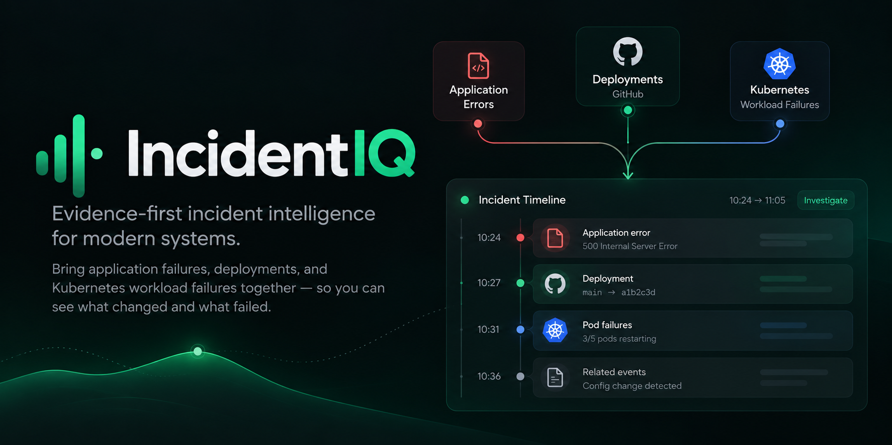

# IncidentIQ

IncidentIQ stores operational evidence—application errors, deployments, and later infrastructure signals—so an investigator can build an explainable incident timeline.

<p align="center">
  
</p>

The current development version is **0.3.0**. It includes a self-hosted API backed by PostgreSQL, a local investigation CLI, a Node.js SDK implementation, and a GitHub Actions deployment-context Action.

## What works today

- Authenticated batch ingestion at `POST /v1/events/batch`
- PostgreSQL event storage, secret-field redaction, and duplicate-event protection
- A CLI to inspect stored events and deterministic fixture investigations
- A fail-open Node.js SDK implementation for application events
- A GitHub Action that records deployment context without failing a deployment

Not yet included: Kubernetes collection, automatic incident detection, a published npm SDK package, or a web dashboard. The CLI is the current investigation interface.

## Start here

For a first local installation, follow [Getting started](docs/getting-started.md). It takes you from PostgreSQL to a running API, an ingestion key, a health check, and a stored event.

```sh
git clone https://github.com/Shreyanshi200/IncidentIQ.git
cd IncidentIQ
corepack enable
pnpm install --frozen-lockfile
cp .env.example .env
docker compose up -d postgres
pnpm incidentiq init
pnpm incidentiq keys create --scope ingest
pnpm api
```

The key command prints an `iiq_...` key once. Store it in a secret manager; do not commit it or put it in a workflow file.

## Documentation

| Guide | Use it for |
| --- | --- |
| [Getting started](docs/getting-started.md) | Self-hosting the API, creating an ingestion key, health checks, and viewing events |
| [GitHub Actions integration](docs/integrations/github-actions.md) | Recording real deployment metadata from a GitHub workflow |
| [Node.js SDK integration](docs/integrations/node-sdk.md) | Adding application error events and understanding the current SDK packaging status |
| [Event data guide](docs/event-data.md) | Knowing which stored fields are generated, configured, or taken from a provider |

## Verify the local installation

In another terminal, after the API has started:

```sh
pnpm incidentiq api health
pnpm incidentiq events list
```

`events list` displays newest events first. It connects directly to PostgreSQL, so it works even if the API process is stopped.

## Development commands

```sh
pnpm test
pnpm incidentiq fixture validate demo/fixtures/deployment-regression.json
pnpm incidentiq fixture load demo/fixtures/deployment-regression.json
pnpm incidentiq correlate demo/fixtures/deployment-regression.json
pnpm incidentiq correlate demo/fixtures/deployment-regression.json --save
pnpm incidentiq incidents list
pnpm incidentiq incidents explain deployment-regression
pnpm incidentiq incidents export deployment-regression --format json
```

`fixture load` is idempotent: loading the same fixture twice never duplicates its source events. `correlate` returns an evidence timeline, ranked causes, score factors, and suggested next checks.

## Release roadmap

| Version | Status | Outcome |
| --- | --- | --- |
| 0.0.1 | Complete | Versioned contracts and canonical fixtures |
| 0.0.2 | Complete | PostgreSQL migrations and idempotent event storage |
| 0.0.3 | Complete | Deterministic cause ranking |
| 0.0.4 | Complete | Readable local investigation CLI |
| 0.1.0 | Complete | Authenticated event-ingestion API |
| 0.2.0 | Complete | Safe Node.js SDK implementation with batched, fail-open export |
| 0.3.0 | Complete | GitHub Actions deployment context |
| 0.4.0 | Planned | Read-only Kubernetes workload signals |
| 0.5.0 | Planned | Automatic incident detection and unified timeline |
| 0.6.0 | Planned | Evidence-bounded AI explanation |
| 0.8.0 | Planned | Reliability, retention, quotas, and cost controls |
| 0.9.0–1.0.0 | Planned | ClickHouse, Kafka, portfolio hardening, and stable MVP |

## CI and image releases

GitHub Actions runs the PostgreSQL-backed test suite for pull requests and pushes to `main`. After a successful `main` CI run, the separate **Publish API image** workflow publishes `ghcr.io/<owner>/incidentiq-api:latest` and an immutable `sha-<commit SHA>` image to GitHub Container Registry.

Protect `main` in GitHub so changes reach it through reviewed pull requests; that makes each image publish correspond to a merged change. Deploy `sha-<commit SHA>` when you need an immutable image, and reserve `latest` for development or a moving mainline environment.

To deploy the image built for a particular merge:

```sh
docker pull ghcr.io/<owner>/incidentiq-api:sha-<commit-sha>
```

The registry image runs the API. In the current version, use a source checkout and the CLI to create ingestion keys and inspect events.
