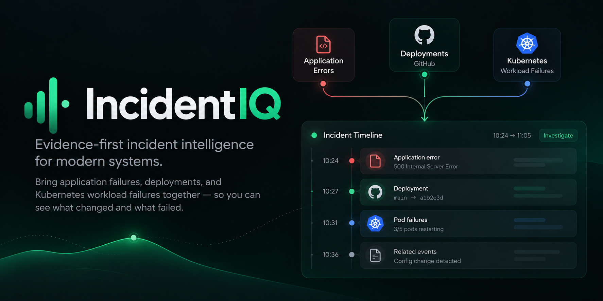
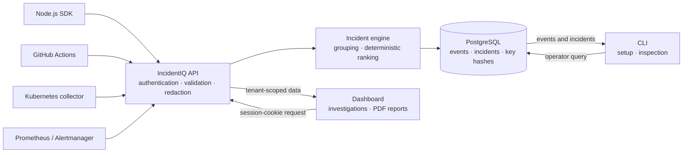
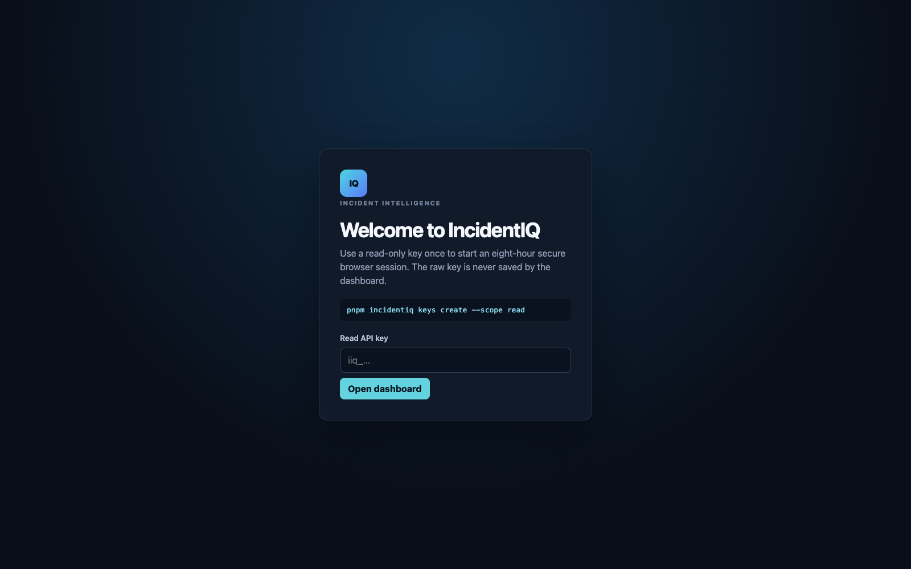
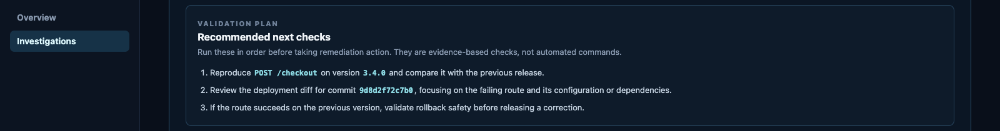
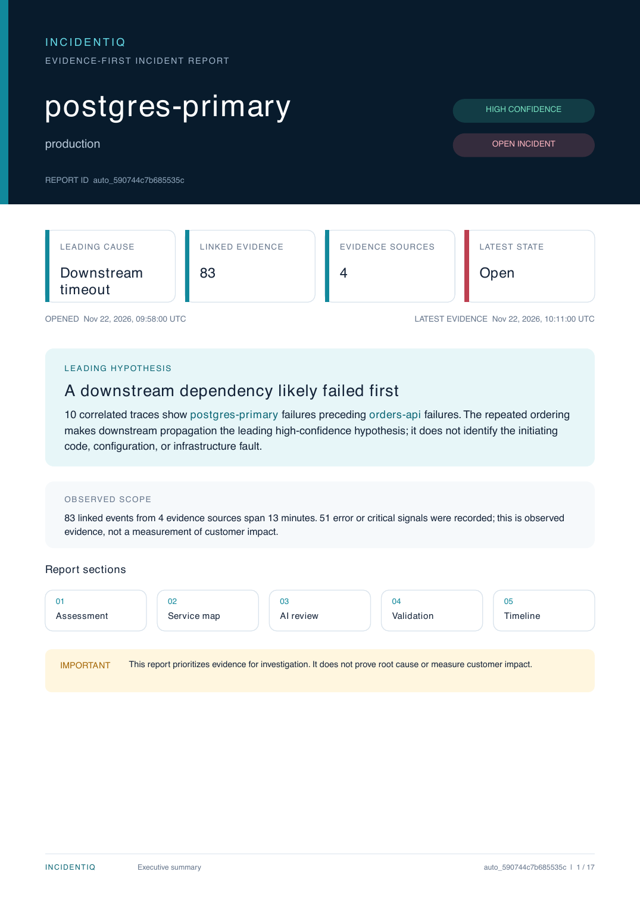

# IncidentIQ

[](https://github.com/Shreyanshi200/IncidentIQ/actions/workflows/ci.yml)
[](https://nodejs.org/)
[](https://www.typescriptlang.org/)
[](https://www.postgresql.org/)

<p align="center">
  
</p>

**IncidentIQ is an evidence-first incident intelligence platform.** It brings application failures, deployments, Kubernetes workload signals, and Prometheus alerts into one time-ordered investigation.

## Table of contents

- [The problem](#the-problem)
- [Quick start](#quick-start)
  - [Prerequisites](#prerequisites)
  - [Installation](#installation)
  - [Configuration](#configuration)
  - [Initialization](#initialization)
  - [Run and verify](#run-and-verify)
- [Features](#features)
- [Architecture and integrations](#architecture-and-integrations)
- [Product tour](#product-tour)
- [Documentation](#documentation)
- [Development](#development)
- [Releases and roadmap](#releases-and-roadmap)

## The problem

When a production service breaks, its clues are usually scattered across application logs, deployment workflows, Kubernetes, and monitoring tools. Engineers lose time rebuilding the sequence of events before they can test a likely cause.

IncidentIQ accepts those signals, validates and redacts them, stores them in PostgreSQL, groups related evidence into incidents, and presents an explainable investigation. Its rankings are deterministic hypotheses backed by recorded evidence—not claims of proven root cause.

## Quick start

This starts PostgreSQL, the API, and the dashboard locally. For explanations and troubleshooting, use the [complete getting-started guide](docs/getting-started.md).

### Prerequisites

- Git
- Node.js 24 or newer
- pnpm 11.6
- Docker Desktop, running locally

Install the repository-pinned pnpm version if needed:

```sh
npm install --global pnpm@11.6.0
```

### Installation

```sh
git clone https://github.com/Shreyanshi200/IncidentIQ.git
```

```sh
cd IncidentIQ
```

```sh
pnpm install --frozen-lockfile
```

### Configuration

```sh
cp .env.example .env
```

The supplied local configuration points to PostgreSQL at `localhost:5432`. Start it with Docker:

```sh
docker compose up -d postgres
```

### Initialization

Apply the database migrations:

```sh
pnpm incidentiq init
```

Create an ingestion key for SDKs and integrations:

```sh
pnpm incidentiq keys create --scope ingest
```

Save the printed `iiq_...` value immediately. IncidentIQ stores only its hash and cannot show the raw key again.

Create a separate read key for the dashboard:

```sh
pnpm incidentiq keys create --scope read
```

### Run and verify

Start the API in one terminal:

```sh
pnpm api
```

Confirm the API can reach PostgreSQL from another terminal:

```sh
pnpm incidentiq api health
```

Expected response:

```json
{"status":"ok"}
```

Start the dashboard:

```sh
pnpm dashboard
```

Open `http://localhost:5173`, paste the read key, and select **Open dashboard**. To create a realistic investigation, follow the [production-like fixture walkthrough](docs/automatic-incidents.md#rehearse-a-production-like-investigation).

## Features

- Authenticated, tenant-scoped event ingestion with shared schema validation and configured secret-field redaction.
- PostgreSQL storage with migrations, idempotent event IDs, and duplicate-delivery protection.
- Automatic incident creation and configurable time-window grouping for error and critical signals.
- Deterministic candidate ranking with supporting evidence, counterevidence, confidence, and contextual next checks.
- React dashboard with Overview and Investigations views, filtering, cursor pagination, readable timelines, and secure read-key sessions.
- Navigable PDF incident reports containing the investigation summary, ranked candidates, validation plan, and complete evidence timeline.
- Fail-open Node.js SDK and GitHub Action, plus a read-only Kubernetes collector and Alertmanager webhook integration.
- CLI workflows for setup, evidence inspection, fixtures, correlation, and saved incidents.

Current boundaries include a single-operator workflow, namespace-scoped Kubernetes collection, and no acknowledgement or resolution workflow. See the [roadmap](docs/roadmap.md) for planned work.

## Architecture and integrations



| Evidence source | What it contributes | Setup guide |
| --- | --- | --- |
| Node.js SDK | Application errors and safe diagnostic context | [Node.js SDK](docs/integrations/node-sdk.md) |
| GitHub Actions | Deployment status, commit, workflow, actor, and run metadata | [GitHub Actions](docs/integrations/github-actions.md) |
| Kubernetes collector | Pod, Deployment, Job, and Kubernetes Event failures | [Kubernetes collector](docs/integrations/kubernetes-collector.md) |
| Prometheus Alertmanager | CPU, memory, latency, error-rate, and other alert lifecycle events | [Alertmanager](docs/integrations/alertmanager.md) |

See [Architecture](docs/architecture.md) for component responsibilities, data flow, security boundaries, and infrastructure ownership.

## Product tour

The gallery uses the included checkout regression fixture: a release followed by application errors, alerts, pod degradation, rollback, and recovery.

<table>
  <tr>
    <td width="50%" valign="top">
      <strong>1. Start a secure session</strong><br><br>
      <a href="assets/screenshots/dashboard-login.png"></a><br>
      <sub>Exchange a read-only key for an eight-hour browser session without storing the raw key.</sub>
    </td>
    <td width="50%" valign="top">
      <strong>2. Review operational coverage</strong><br><br>
      <a href="assets/screenshots/dashboard-overview.png"></a><br>
      <sub>See which services, environments, and integrations are contributing evidence.</sub>
    </td>
  </tr>
  <tr>
    <td width="50%" valign="top">
      <strong>3. Browse investigations</strong><br><br>
      <a href="assets/screenshots/investigations.png"></a><br>
      <sub>Filter saved incidents and select one for deeper inspection.</sub>
    </td>
    <td width="50%" valign="top">
      <strong>4. Inspect the hypothesis</strong><br><br>
      <a href="assets/screenshots/investigation-detail-highlights.png"></a><br>
      <sub>Review the leading hypothesis, observed scope, alternatives, and evidence highlights.</sub>
    </td>
  </tr>
  <tr>
    <td width="50%" valign="top">
      <strong>5. Follow recommended checks</strong><br><br>
      <a href="assets/screenshots/recommended-next-steps.png"></a><br>
      <sub>Use the incident-specific validation plan before choosing a remediation.</sub>
    </td>
    <td width="50%" valign="top">
      <strong>6. Read the evidence timeline</strong><br><br>
      <a href="assets/screenshots/evidence-timeline.png"></a><br>
      <sub>Follow readable events in time order and expand their original attributes.</sub>
    </td>
  </tr>
  <tr>
    <td colspan="2" align="center" valign="top">
      <strong>7. Download the incident report</strong><br><br>
      <a href="assets/screenshots/incident-report-cover.png"></a><br>
      <sub>Export a navigable PDF containing the summary, ranked candidates, supporting and counterevidence, validation plan, and complete timeline.</sub>
    </td>
  </tr>
</table>

## Documentation

| Guide | Use it for |
| --- | --- |
| [Getting started](docs/getting-started.md) | Detailed local setup, keys, integrations, and production pointers |
| [Architecture](docs/architecture.md) | Components, end-to-end data flow, security boundaries, and infrastructure ownership |
| [Dashboard](docs/dashboard.md) | Local or hosted dashboard setup and investigation workflow |
| [Automatic incidents](docs/automatic-incidents.md) | Incident opening, grouping, realistic fixtures, and current boundaries |
| [Production deployment](docs/deployment/api-production.md) | HTTPS, PostgreSQL, static dashboard hosting, backups, upgrades, and rollback |
| [Event data](docs/event-data.md) | Which event fields are generated, configured, or supplied by integrations |
| [Changelog](CHANGELOG.md) | Completed releases and notable changes |
| [Roadmap](docs/roadmap.md) | Planned releases and future extensibility |

## Development

Build every workspace package:

```sh
pnpm build
```

Run the complete automated test suite:

```sh
pnpm test
```

Tests require PostgreSQL. The local Docker database from Quick start is sufficient.

## Releases and roadmap

See [CHANGELOG.md](CHANGELOG.md) for completed work and [the release roadmap](docs/roadmap.md) for planned versions. Production deployments should use immutable `sha-<commit-sha>` container tags as described in the [production deployment guide](docs/deployment/api-production.md).
