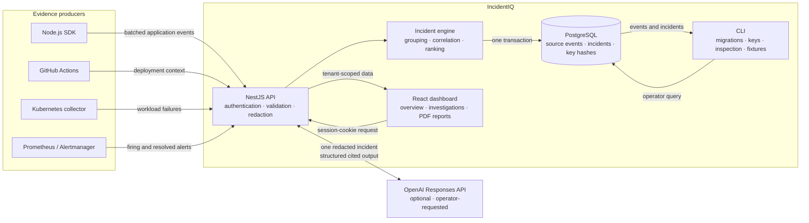

# Architecture

IncidentIQ is a self-hosted TypeScript monorepo. Evidence producers send normalized events to one API, the incident engine groups and ranks related evidence, PostgreSQL stores the result, and operators investigate it through the dashboard or CLI.

## System overview

## End-to-end data flow

1. A producer assigns a stable tenant, environment, service, event type, severity, occurrence time, and event ID.
2. The API authenticates the ingestion key and requires the event tenant to match the key's tenant.
3. The shared event schema validates the payload. The API replaces configured secret-like attribute fields with `[REDACTED]` and assigns its own receipt time.
4. PostgreSQL inserts the source event by unique event ID. A retry of the same event becomes a safe duplicate rather than another observation.
5. For a newly inserted event, automatic detection opens or enriches an incident for the same tenant, service, and environment. The event and incident update run in the same database transaction.
6. The deterministic correlation package ranks candidate causes from recorded timing, entity, version, route, dependency, and resource evidence. Repeated factors are aggregated and their score contribution is capped after three occurrences, while every linked event remains traceable. Scores prioritize investigation; they are not probabilities.
7. An operator uses a read key once to create a tenant-scoped dashboard session. The dashboard loads the overview, incident list, detail, timeline, and PDF report through the API.
8. When explicitly requested and configured, the API sends only that incident's redacted stored evidence to OpenAI. It accepts a structured response only when every claim and check cites event IDs from the incident, then caches the result until new evidence replaces the investigation.
9. The CLI is an operator tool for migrations, key creation, evidence inspection, fixtures, and saved-incident workflows. It connects directly to PostgreSQL in the current single-operator architecture.

## Component responsibilities

| Component | Location | Responsibility |
| --- | --- | --- |
| API | `apps/api` | Ingestion, Alertmanager webhook, authentication, validation, redaction, automatic incidents, optional AI explanation validation, dashboard endpoints, and PDF generation |
| Dashboard | `apps/dashboard` | Secure Overview and Investigations interface for one read-key tenant |
| CLI | `apps/cli` | Database initialization, key creation, fixture workflows, event listing, correlation, and incident inspection |
| Event schema | `packages/event-schema` | Shared TypeScript event contract and runtime validation |
| Correlation | `packages/correlation` | Ordered timelines, deterministic candidate scoring, confidence, and next checks |
| Node.js SDK | `packages/node-sdk` | Bounded in-memory batching and fail-open application-event delivery |
| GitHub Action | `integrations/github-action` | Fail-open deployment context from a GitHub workflow |
| Kubernetes collector | `integrations/kubernetes-collector` | Namespace-scoped, read-only watches for curated Pod, Event, Deployment, and Job failures |
| PostgreSQL | `infrastructure/postgres` | Durable events, incidents, event links, migrations, and API-key hashes; application queries use Kysely |

## Integration contract

Every producer uses an ingestion key and the API's HTTPS base URL. The fields that make cross-source evidence useful must stay stable:

- `tenant_id` must match the ingestion key's tenant;
- `service` must identify the same deployable service across every producer;
- `environment` must use the same name across deployment, application, Kubernetes, and alert evidence;
- `occurred_at` must represent when the source observed the event;
- `event_id` must be stable across retries; and
- optional `version`, `resource`, `trace_id`, route, dependency, and commit attributes improve correlation and explanations.

See the [event data guide](event-data.md) for field ownership and the source-specific setup guides for the [Node.js SDK](integrations/node-sdk.md), [GitHub Actions](integrations/github-actions.md), [Kubernetes collector](integrations/kubernetes-collector.md), and [Alertmanager](integrations/alertmanager.md).

## Security and tenant boundaries

- Ingestion and read keys are separate. IncidentIQ stores only their hashes and operator-visible metadata; optional expiry and revocation are enforced on every authenticated request.
- An ingestion key can write events only for its assigned tenant.
- A read key starts an eight-hour signed browser session that can load only that tenant's dashboard data and reports.
- The raw read key is not stored in browser storage; the session cookie is `HttpOnly` and `SameSite=Strict`, with `Secure` on HTTPS.
- `INCIDENTIQ_SESSION_SECRET` signs browser sessions and is unrelated to either API key.
- `OPENAI_API_KEY` is optional, remains server-side, and is sent only to OpenAI. Enabling it sends the selected incident's redacted operational evidence to that external processor.
- PostgreSQL and the API container port should remain private behind an HTTPS reverse proxy.
- Production responses include request IDs and defensive headers; JSON request logs exclude headers and bodies.

## Infrastructure ownership

The current product is self-hosted. The operator provides and owns:

- PostgreSQL, its backups, retention, network policy, and TLS settings;
- the API host or container platform and its HTTPS endpoint;
- static hosting for the dashboard on the same origin as `/v1`;
- GitHub, Kubernetes, Prometheus, Alertmanager, and application infrastructure; and
- secret storage for ingestion keys, read keys, database credentials, and the session secret; and
- an OpenAI account, API key, model choice, usage budget, and data-processing approval when optional AI explanations are enabled.

IncidentIQ supplies the API and collector images, npm SDK, GitHub Action, database migrations, integration configuration, dashboard build, and operating guides. Kafka and ClickHouse are planned scale options, not requirements for the current release.

## Current boundaries

- One API process and PostgreSQL are the supported production shape.
- Session and AI rate limits are process-local and reset when that API process restarts.
- The dashboard is single-operator and has no acknowledgement, assignment, or resolution workflow.
- Automatic grouping is limited to one tenant, service, and environment; dependency-aware cross-service correlation is planned for v0.8.2.
- Kubernetes collection is namespace-scoped and keeps watch checkpoints in memory.
- Correlation remains evidence-bounded and deterministic. Optional AI output is a cited second opinion and never changes stored scores or grouping.

For deployment details, follow the [production API deployment guide](deployment/api-production.md). For planned architectural changes, see the [roadmap](roadmap.md).
